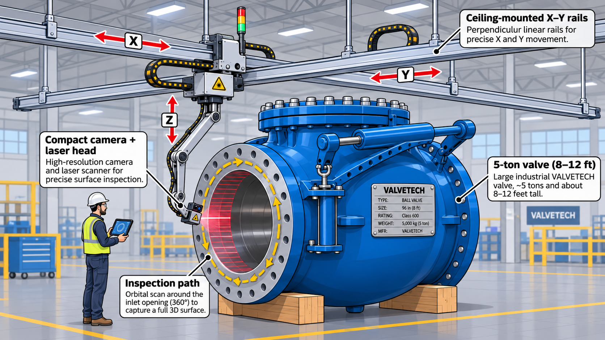
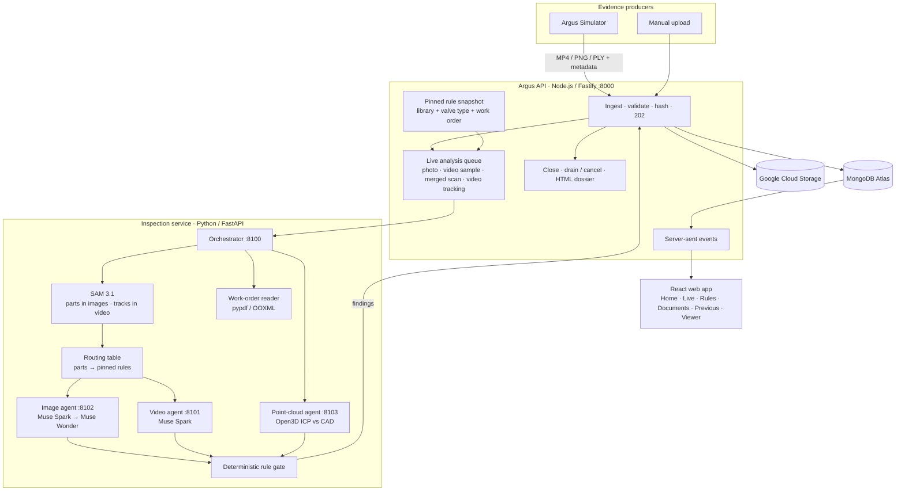

# Argus

**Autonomous, continuous inspection AI for engineer-to-order (ETO), high-mix low-volume industrial manufacturing.**

Argus watches a one-off, high-value piece of equipment while it is being built — through camera video, close-up photographs and 3D laser scans — and checks what it sees against the design (CAD) and the rules that apply to that exact order. It does this at every stage of the build, not once before delivery, and produces a traceable dossier of every finding for a human quality engineer to sign off.

Built for the Meta "Push the Frontier" hackathon on Meta's Muse Spark, Muse Wonder and SAM 3.1 models. The demo inspects a real 48-inch APCO CVS-6000D air-cushioned swing check valve design.

---

## Contents

1. [The problem: batch size of one](#1-the-problem-batch-size-of-one)
2. [Where Argus applies: ETO and high-mix industries](#2-where-argus-applies-eto-and-high-mix-industries)
3. [Why it is a problem today, and what it costs](#3-why-it-is-a-problem-today-and-what-it-costs)
4. [Continuous, multi-stage inspection](#4-continuous-multi-stage-inspection)
5. [How Argus solves it](#5-how-argus-solves-it)
6. [What you see in the product](#6-what-you-see-in-the-product)
7. [How we collected the data](#7-how-we-collected-the-data)
8. [Meta models: why they matter and how we used each one](#8-meta-models-why-they-matter-and-how-we-used-each-one)
9. [Architecture](#9-architecture)
10. [Tech stack](#10-tech-stack)
11. [Running it locally](#11-running-it-locally)
12. [Deployment](#12-deployment)
13. [What we learned](#13-what-we-learned)
14. [Status, limits and roadmap](#14-status-limits-and-roadmap)
15. [Repository map and documents](#15-repository-map-and-documents)

---

## 1. The problem: batch size of one

Severe-service valves, custom pumps and turbomachinery are **engineered to order**: designed for one plant's pressures, temperatures and fluids, and built once. A single unit regularly costs **$50,000 to $1,200,000+**. Statistical sampling ("inspect 5 of 100") does not apply — every unit needs 100 % verification against its own drawings and its own order.

Existing approaches do not fit:

- **Configure-to-order rule engines** check that standard catalogue parts were combined correctly. An ETO valve has custom castings, wall thicknesses, trim and face-to-face dimensions designed from scratch — there is no catalogue baseline to check against.
- **Conventional vision AI** (YOLO-style defect classifiers) needs thousands of images of good and bad parts. For a unit that has never existed before, there are zero training images.
- **Metrology today is semi-manual.** Plants own 3D scanners, CMM arms and digital travelers, but a quality engineer still imports the CAD by hand, aligns each scan to it by hand, and cross-references paper checklists and work orders — 45 to 60 minutes per check, once, late in the build.

## 2. Where Argus applies: ETO and high-mix industries

Argus fits wherever equipment is **engineered or built to a customer's specification**, in quantities of one or a few, at high unit value — so every unit must be verified against its own design and order, and a missed defect is expensive, dangerous or both:

| Industry | Typical one-off or low-volume assets | Why inspection matters |
|---|---|---|
| **Industrial valves and flow control** | Large severe-service valves (gate, globe, check, ball, control), actuated assemblies, custom trims | Pressure-boundary failures; FAT teardown; field blow-outs (the demo case) |
| **Oil and gas, petrochemical** | Wellheads, subsea manifolds and trees, compressors, pressure vessels, skid packages | Sour and high-pressure service; offshore rework is extremely costly |
| **Power generation** | Steam and gas turbines, generators, boiler and nuclear-island components, hydro turbines | Long outages and safety cases; strict code compliance (ASME, nuclear QA) |
| **Pumps, compressors and turbomachinery** | Engineered pumps, impellers, casings, rotors, gearboxes | Custom hydraulics and metallurgy; balance and clearance errors surface late |
| **Defence** | Naval systems, armoured-vehicle structures, weapon-system and ordnance components, ground-support equipment | Mission-critical, low-volume, heavily specified; full traceability required |
| **Aerospace and space** | Engine components, landing gear, structural assemblies, launch-vehicle and satellite hardware, MRO repairs | Zero-defect tolerance; first-article and per-unit inspection; documentation-heavy release |
| **Shipbuilding and marine** | Propulsion shafts and propellers, steering gear, hull modules, offshore structures | Very large one-off parts; class-society inspection at every stage |
| **Heavy machinery, mining and cement** | Crushers, mills, kilns, large castings and forgings, presses | Huge castings where a void found after machining wastes weeks |
| **Energy transmission and grid** | Power transformers, switchgear, HV/HVDC components | Custom-rated units; failures cascade across the grid |
| **Rail and transport** | Bogies, traction equipment, special-purpose vehicles | Safety-critical, specified per operator |
| **Process plants and capital equipment** | Heat exchangers, reactors, columns, semiconductor and pharma process tools | Built to the plant's process data sheet; failures halt production |

What these share is exactly what Argus is built for: **batch size of one, a CAD model and a customer specification per unit, staged manufacturing, and evidence (photos, video, 3D scans) that is already captured but checked manually and late.** The same pipeline — pinned CAD and rules, live evidence, part detection, rule-by-rule reading and a deterministic decision — carries over by adding the equipment family's parts and rules; the valve is the first case.

## 3. Why it is a problem today, and what it costs

Inspection usually happens at the end: factory acceptance testing (FAT) or a final visual check before dispatch. By then the casting is machined, the bonnet is torqued shut, the body is painted and the nameplate is riveted on. A mistake found there is expensive, and a mistake missed there can be catastrophic:

| Where the deviation is caught | Typical cost |
|---|---|
| Raw casting, before machining | ~$1,000 (reject the casting before 40 h of CNC) |
| During assembly | ~$5,000 (rework seat, weld or fasteners) |
| At acceptance testing (FAT) | **$150,000+** — quarantine, teardown, scrapped seals, re-machining, contractual delay penalties |
| In the field (blow-out under 2,500 psi superheated steam) | **$50,000,000+** — ~$35M unplanned downtime ($1–2.5M per day), ~$8M collateral damage, $5M+ regulatory fines, ~$2.5M insurance and legal |

The earlier a deviation is caught, the cheaper it is — but nobody can afford a quality engineer standing at every station of a one-off build.

## 4. Continuous, multi-stage inspection

Argus inspects **the same asset again and again as it is built**, each time against the CAD available for that stage of assembly and the rules that belong to that stage:

```
[ Intake / Raw casting ] ─► [ Machining ] ─► [ Sub-assembly ] ─► [ Final assembly ] ─► [ Finish & nameplate ] ─► [ Test & dispatch ]
   casting CAD              machined CAD      sub-assembly CAD     full-assembly CAD      as-built CAD + order       test records
```

- **CAD per stage:** compare against the design as it should exist at that point, not only the final drawing.
- **Rules per stage:** casting checks early; fasteners and trim during assembly; paint, nameplate, end protection and documents at finish; test records at dispatch. A missing face protector during build is expected; at dispatch it is a finding.
- **Continuous while the stage runs:** findings appear live as each video segment, photograph and scan chunk is analysed.
- **History across stages:** inspections of the same work order and asset are grouped, and each inspection shows how every rule stood at the earlier stages.

**In the demo** the same valve is inspected at two stages: **Scenario 1 — during build** (grey, before finishing, no nameplate) and **Scenario 2 — finished** (painted and nameplated). Uploading the work order with each inspection groups them automatically; the finished stage surfaces what the build stage could not show yet — for example a nameplate that does not match the work order.

## 5. How Argus solves it

Argus inspects against **design intent** instead of training data.



*Concept illustration of the target shop-floor setup. A gantry-mounted camera and laser head travel around the valve at each build stage and stream evidence to Argus, and the inspector follows the findings live. The illustration is not the demo valve, and the nameplate and brand shown are fictional.*

> **In this prototype, the camera feed, photographs and laser point cloud are simulated.** No gantry, camera or scanner hardware is connected. The separate Argus Simulator streams prepared evidence of the demo valve through the same public API a real cell would use: video segments, photographs generated from real imagery, and a simulated 180° laser scan split into point-cloud chunks. Everything downstream of ingestion is the real system: SAM 3.1 part detection, rule routing, Muse screening and review, CAD-to-scan registration, the rule gate and the dossier. Connecting real sensors means pointing them at the same API.

How it works:

1. **Pin what the asset must satisfy.** When an inspection starts, Argus pins the CAD model, the rules from its indexed rule library that apply to this valve type and end connection, and — if the customer's work order is uploaded (PDF, Word or Excel) — the rules printed in that order, quoted verbatim. Nothing is inferred from narrative text. This snapshot never changes for that inspection.
2. **Take evidence as it arrives.** A camera, a photo station and a laser scanner stream files to Argus's public API (in this prototype, the Argus Simulator plays that role). Each file is stored, hashed and shown immediately.
3. **Find the parts in each image — SAM 3.1.** For every photograph and sampled video frame, SAM 3.1 says which valve parts are visible (flange face, nameplate, bonnet bolting, lever, air-cushion cylinder …), with masks and boxes.
4. **Route only the relevant rules.** A deterministic routing table maps visible parts to the pinned rules about those parts. A flange close-up is checked against flange rules only. Rules that need records the image cannot show (test certificates, measurements) are skipped, or reported as "evidence needed" if they are critical.
5. **Read the evidence against each rule — Muse Spark, then Muse Wonder.** Muse Spark screens each routed rule on the image, with the work order text when the rule compares against the order; Muse Wonder reviews anything flagged or high-stakes. Both return observations only — never verdicts.
6. **Measure the geometry — deterministically.** All laser-scan chunks are merged and registered to a reference point cloud derived from the CAD (Open3D ICP). Argus reports surface coverage and RMS / 95th-percentile deviation, and scan rules are decided only against approved thresholds, after a registration-quality gate.
7. **Decide with a rule gate, not a model.** A deterministic gate turns observations and measurements into PASS / WARNING / FAIL / INSUFFICIENT EVIDENCE per rule. A model timeout is never a pass; a hairline seen in a photo is a warning for review, never a certified failure.
8. **Close and report.** The inspection closes automatically once the feed is complete and analysis has finished, or the operator ends or terminates it earlier. Argus waits for running analysis (or cancels it), freezes the results and writes a dossier (PDF, prepared by the report agent, plus HTML) with each rule's quote and citation, the evidence and its hashes, the scan metrics and anything left incomplete. Nothing is released automatically.

Everything runs live: the operator watches findings appear while the evidence is still streaming.

## 6. What you see in the product

- **Home** — every inspection with lifecycle, outcome and a findings bar; inspections of the same work order / asset are grouped and listed in stage order. Start an inspection by name, CAD model and optional work order.
- **Inspection Rules** — the indexed rule library (161 rules from 19 documents), searchable by stage, section and evidence type.
- **Summary and recommendation** — once an inspection closes, an AI-generated (Muse Wonder) reasoning summary and recommended action at the top of the page, before the details. Advisory; the engineer decides.
- **Live inspection** — video, photographs, merged point cloud and CAD reference panes; an evidence timeline; the stage indicator; live findings; the CAD-vs-scan comparison.
- **Applicable Rules** — the selection funnel (library → valve type → customer specification), every rule with its status, quote, citation and reason, and *Why these rules*.
- **Documents** — every evidence file, the pinned CAD, the rule snapshot, the uploaded work order and the dossier, each with size, hash and download.
- **Previous Inspections** — earlier inspections of the same order and asset, and how each rule stood at each stage (reference only).
- **Viewer dialog** — photographs with SAM 3.1 masks; the video as **Original video** and **Analyzed video** (parts tracked by SAM 3.1 with lightly worded "possible issue" hints from the findings); the merged 3D point cloud and the CAD reference cloud, orbitable.
- **Dossier / Reports** — the frozen report per inspection, downloadable as PDF.

The companion **Argus Simulator** (separate repository) streams prepared evidence to a chosen inspection, per source in parallel, with retry and stop.

## 7. How we collected the data

All data is **public or synthetic — no proprietary or customer data**.

| Data | Source |
|---|---|
| **CAD** | The real, publicly downloadable STEP model of a 48-inch APCO CVS-6000D air-cushioned swing check valve (DeZURIK product family), converted to STL. Argus samples it into a 680,000-point reference cloud for scan comparison. |
| **Inspection rules** | Real, public inspection material: an ASME B16-based visual inspection checklist for valves before delivery, and public OEM assembly, torque and test sheets (nameplate and tagging, torque procedures, assembly sequences, regulator and control-valve tests, release gates). Indexed into 161 rules. All rule documents are treated as one manufacturer's rule set for the demo. |
| **Work order** | A synthetic demonstration work order for the same valve (`WO-ARGUS-CVS48-001`, fictional customer), with a numbered rule table (WO-R01 … WO-R07), a manufacturing traveler and hold points. Marked "demonstration document — not for production release". |
| **Photographs and video** | Simulated inspection imagery of the same valve generated from real imagery — Scenario 1 during build (grey, no nameplate) and Scenario 2 finished (painted, nameplated). In the finished-stage imagery Argus flagged a nameplate that does not match the order and a fine line near a flange sealing face (the work order lists a hairline near a sealing face as an optional planted condition). |
| **Laser point cloud** | A simulated 180° laser scan of the same valve (≈ 750,000 points, mm, with colour), split by the simulator into 50,000-point chunks. |

The simulator only sends files — it never sends ground truth, defect labels or expected results.

## 8. Meta models: why they matter and how we used each one

In ETO there is nothing to train on, so the models must work **zero-shot**: find a nameplate they have never seen, on a valve that has never existed, and read it against rules they are given at run time. Meta's models do the perception and reading; deterministic code does the deciding.

| Model | Where it runs | What it does in Argus |
|---|---|---|
| **SAM 3.1 — images** (`sam-3.1`) | Inspection orchestrator, per photograph / video keyframe | One concept prompt per relevant valve part ("flange face", "metal nameplate", "bolts on valve bonnet", "lever arm with counterweight", "pneumatic cylinder" …), run in parallel. Detected parts decide which rules are applied to that image (routing). Boxes and one-bit masks are stored and drawn over photographs in the viewer. |
| **SAM 3.1 — video** (`sam-3.1`, `input_video`) | Inspection orchestrator, once per inspection | Tracks each relevant part through the merged inspection video with stable object identities (on a 5 fps copy, because video is billed per frame). Powers the **Analyzed video** tab, where possible issues follow the part they concern. Display only. |
| **Muse Spark 1.3** (`muse-spark-1.3`) | Image and video agents | Tier-1 screening: for each routed rule, reads the image (or video keyframe; the clip for motion rules) against the rule's exact wording, and — when the rule compares against the order — against the uploaded work order text. Returns a structured observation (`component_present / component_absent / possible_surface_line / no_component`, certainty, note). |
| **Muse Wonder 1.0** (`muse-wonder-1.0`) | Image agent | Tier-2 review of flagged, uncertain or critical items (flange faces, nameplate, bonnet). An additional observation, never a replacement verdict. |
| **Muse Wonder 1.0 — summary** (`muse-wonder-1.0`) | Inspection orchestrator, once per closed inspection | Reads the frozen results and writes a short reasoning summary with a recommended action (proceed to sign-off, review, hold for rework, or collect more evidence) and up to three next steps. Shown at the top of the completed inspection, labelled AI-generated and advisory; it never changes a rule status. |
| **Muse Code** | Development | Used by the team as an AI coding assistant while building Argus. Not a runtime dependency. |

What the models never do: issue verdicts, invent tolerances or citations, measure millimetres, or release a product. Those stay with the deterministic rule gate, the geometry code and the human reviewer.

## 9. Architecture


<details>
<summary>Text version (Mermaid)</summary>



</details>

- One **API** owns ingestion, sessions, pinned snapshots, the live analysis queue, SSE, closure and dossiers.
- One **orchestrator** plus three **agent services** (video, image, point cloud), each its own process and container; the orchestrator routes each evidence item to the agent for its media type and runs independent items in parallel.
- One **deterministic rule gate** issues every verdict.
- The diagram above is the current design; it is described in detail in [Agentic Architecture v1.0](docs/architecture/Argus_Agentic_Architecture.md).

## 10. Tech stack

| Layer | Technology |
|---|---|
| Web | React 19, TypeScript, Vite, Three.js (point clouds), SVG overlays; dark operations UI ported from the design mockup |
| API | Node.js 22, TypeScript, Fastify, multipart ingestion, server-sent events, in-process bounded analysis queue |
| Inspection service | Python 3.12, FastAPI, Open3D + NumPy (registration, deviation, coverage), ffmpeg (video segments, keyframes, 5 fps proxy), pypdf (work orders), `meta-sam-parser` |
| Models | Meta Model API: `muse-spark-1.3`, `muse-wonder-1.0`, `sam-3.1` |
| Data | MongoDB Atlas (sessions, snapshots, evidence, observations, findings, events, dossiers); Google Cloud Storage (original bytes, documents, dossiers) |
| Ops | Docker / Docker Compose (6 containers + simulator), Google Cloud Logging (structured logs), Google Cloud Run (target deployment) |
| Tests | Vitest (API 38, web 10, simulator 9), pytest (48) — including a recorded live SAM 3.1 image stream and video stream |

## 11. Running it locally

Requirements: Docker Desktop, a Meta Model API key, and (optionally) a MongoDB Atlas URI and a GCS bucket.

```bash
# Argus
cd argus
cp .env.example .env          # set META_API_KEY, META_ADAPTER_LIVE=1, MONGODB_URI, GCS_BUCKET, ARGUS_INGEST_TOKEN …
docker compose up -d --build  # api :8000 · orchestrator :8100 · agents :8101-8103

# Simulator (separate repository)
cd ../argus_simulation
cp .env.example .env          # ARGUS_BASE_URL, same ARGUS_INGEST_TOKEN
docker compose up -d --build  # http://localhost:4173
```

Demo walkthrough:

1. Open **http://localhost:8000**, start an inspection: name it, pick **Scenario 1** as the CAD model, upload `src/reference-data/cvs6000d-48-demo/customer-documents/Argus_CVS6000D_48in_Work_Order.pdf`. Copy the inspection ID.
2. Open **http://localhost:4173**, choose **Scenario 1**, paste the ID, press **Send Simulated Data**. Watch evidence, findings and the scan comparison arrive live in Argus.
3. When Argus shows *Ready to close*, press **End Inspection** and open the **Dossier**.
4. Repeat with **Scenario 2** and the same work order. Home groups both inspections; the new inspection's **Previous Inspections** tab compares the stages; the video viewer's **Analyzed video** tab shows the possible issues on the tracked parts.

Without Docker: `npm start` in `argus` (API + web on :8000) and `scripts/run_inspection.sh` (orchestrator + agents; needs the Python venv in `src/services/inspection/.venv`). Tests: `npm test`.

## 12. Deployment

- **Today:** Docker Compose on one machine; MongoDB Atlas and GCS in the cloud; Cloud Logging when GCP credentials are present.
- **Target:** Google Cloud — Cloud Run for the API, orchestrator, three agents and the simulator; Artifact Registry; Secret Manager; a Cloud Storage bucket mounted into the API; Direct VPC egress with Cloud NAT for a static outbound IP (MongoDB Atlas allow-list, Meta API). Step-by-step guide: **[docs/deployment/GCP_Deployment.md](docs/deployment/GCP_Deployment.md)**.

## 13. What we learned

**By the numbers (Meta Model API usage while building and testing Argus)**

| Measure | Value |
|---|---|
| Video frames segmented by SAM 3.1 | ~7,700 |
| Images segmented by SAM 3.1 | 996 |
| API requests | ~4,000 |
| Input tokens | ~6.6 M |
| Output tokens | ~3.5 M |
| Muse image call latency | 9–13.5 s on average per call |
| SAM 3.1 image concept latency | ~2 s median once warm; ~60–80 s on a cold first call |
| Full inspection (one scenario: 12 photos, 5 sampled video segments, 16 scan chunks) | ~12 min with 3 items analysed in parallel → **~5.5 min with 6** |

- **Latency, not rate limits, sets the pace.** The API reports 3,000 requests and 4 M tokens per window; a burst of 30 parallel Muse calls all returned in ~15 s. One inspection makes a few hundred Muse calls (one per routed rule per photo or video keyframe, plus reviews), so the run time is decided by how many calls are in flight at once — doubling analysis parallelism halved the run.
- **Count calls before optimising code.** Every routed rule is one ~10 s call; the next large saving is fewer calls (several rules per image in one call, skipping rules already passed), not faster code.

**SAM 3.1**
- It is excellent on real photographs — the nameplate was found at 94 % confidence, bonnet bolts individually — and it keeps stable object identities through video.
- One concept per request: detecting ten parts is ten requests. The first call took ~80 s (cold); later calls 3–9 s. We run concepts in parallel, cache by image hash and concept, and only prompt for parts that can route at least one of the inspection's rules.
- Video is billed per frame (minimum 50). Sending a 5 fps copy instead of 30 fps cut a 30-second clip from ~900 to 151 frames with tracking still smooth enough for overlays.
- It does **not** recognise parts on rendered CAD views: on plain renders it found only "the valve", on shaded renders only bolt heads. CAD part labels must come from the CAD itself (our STL splits into 41 bodies — lever arms, cylinders, brackets).
- Use Meta's `meta-sam-parser` rather than parsing the token stream by hand; masks convert directly to SVG paths for overlays.

**Muse Spark and Muse Wonder**
- Constrain the answer to a small enum (`component_present`, `component_absent`, …) and validate it; free text never becomes a verdict, citation or tolerance.
- Wording matters: for "no X allowed" rules the model sometimes answered `component_absent` meaning "no defect present", which the gate reads as a failure. Asking "requirement met / not met" is the fix we would make next.
- Giving the model the uploaded work order text let it catch a real mismatch: nameplate reads "SAMSON", the order specifies APCO.
- Tiering keeps cost down: Spark screens every routed rule; Wonder adds a second reading only on flagged, uncertain or critical items.
- Send downscaled stills and keyframes, not whole clips, unless the rule is about motion.

**Muse Code**
- Used throughout development as a coding assistant. _(Team: add your notes here.)_

**CAD**
- A STEP assembly keeps its structure even as STL: separate bodies give exact part boxes without any model.
- Generate the comparison reference from the CAD (uniformly sampled surface points, cached by CAD hash) — it is derived design intent, not evidence, and is labelled that way.
- One CAD per model is not enough for continuous inspection; each stage needs the CAD of that stage.

**Laser point cloud**
- Read the PLY vertex stride from the header: a hard-coded 16-byte stride (the file had 17) silently corrupted every chunk after the first.
- Measure point-to-plane along CAD normals: nearest-point distance to a sampled CAD cloud mostly measured the sampling spacing (RMS 4.2 mm → 2.0 mm once corrected).
- Compute coverage from the CAD side (CAD points within reach of the scan): the reverse direction undercounted (58 % → 94.6 %).
- Coverage needs the merged scan — a single 50,000-point chunk covers ~8 % of the valve.
- Gate every millimetre claim on registration quality (ICP fitness and coverage) and an approved threshold; otherwise report "insufficient evidence".

**Engineering**
- Keep perception (models) and judgement (deterministic gate) apart; it makes every finding explainable and testable.
- Pin the rules per inspection: a library edit must never rewrite a past result.
- Long model calls break default HTTP clients — Node's `fetch` gives up after 300 s without response headers; SAM video tracking takes longer.

## 14. Status, limits and roadmap

- **Status:** hackathon build, frozen for the demo; all features above are implemented and tested.
- **Limits:** findings assist a human reviewer — no certification or automatic release; no crack-depth, torque or leak claims from images; photo-to-CAD alignment is not computed; a finding names a part type, so its video hint is drawn on every instance of that part; the two demo stages share one CAD.
- **Roadmap:** CAD per stage and rules that switch on by stage; component dimension boxes in the 3D viewer (CAD vs scan); estimated photo-to-CAD alignment view; per-instance attribution of findings; requirement-met / not-met answers from the models.

## 15. Repository map and documents

```
argus/
├── src/apps/api/              Fastify API: ingestion, snapshots, analysis queue, SSE, closure, dossier
├── src/apps/web/              React app
├── src/services/inspection/   Orchestrator, agents, SAM/Muse adapter, routing, geometry, work-order reader
├── src/inspection_rules/      Rule source documents (markdown)
├── src/reference-data/        Rule index, rule metadata, SAM routing table, CAD reference cloud, demo work order
├── src/cad_models.json        CAD registry (model, valve type, end connection, hash)
├── docs/                      Pitch, spec, architecture, PRDs, UX mockups, deployment, notes
└── docker-compose.yml         Local stack
```

- [Product pitch](docs/product_pitch.md) · [Feature spec](docs/specs/Argus_Spec.md) · [Agentic architecture](docs/architecture/Argus_Agentic_Architecture.md) · [Tech stack](docs/architecture/Argus_Tech_Stack.md)
- [PRDs](docs/prd/README.md) · [Folder structure](docs/folder-structure.md) · [Cycle notes](docs/notes-2026-11-02-cycle-1.md) · [GCP deployment](docs/deployment/GCP_Deployment.md)
- Simulator: the `argus_simulation` repository (prepared-evidence sender, same API contract).
