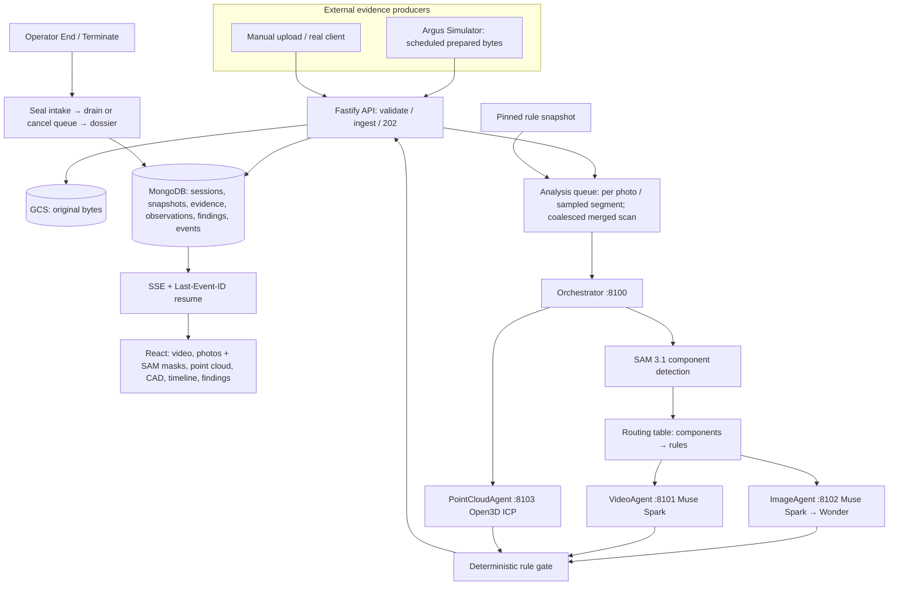

# Argus — Agentic Inspection Architecture

**Document version:** 1.0 · 03 November 2026 (supersedes 0.9 of 02 Nov)  
**Repository:** `argus`  
**Functional contract:** `docs/specs/Argus_Spec.md` — Feature Specification v0.9  
**Related:** `docs/architecture/Argus_Tech_Stack.md` v1.0; PRD-07 (coordinator), PRD-10 (SAM routing); `argus_simulation` Simulator spec  
**Status:** Describes the implemented architecture; not a claim that the inspection tooling has been validated on physical equipment.

## 1. The capability being demonstrated

Argus performs **order-specific visual and geometric inspection** of a unique/high-value ETO assembly while evidence arrives. It begins with the registered **48-inch CVS 6000D swing-check-valve CAD** (`cad_models.json`), the indexed rule library and, when uploaded, the customer's work order, then progressively correlates:

- camera video segments (sampled keyframes) and close-up photographs;
- SAM 3.1 component detections (boxes + masks) on those images;
- 3D laser point-cloud chunks merged and registered to a reference cloud derived from the CAD;
- the session's **pinned rule snapshot**, including the numbered rules printed in the work order.

The value is avoiding expensive misses and rework while creating a defensible inspection dossier. The MVP does **not** operate a gantry, inspect X-ray/CT, measure bolt torque, test pressure, infer subsurface crack depth from surface photos or use acoustic analysis.

## 2. Agentic boundary: an orchestrator with media sub-agents, one deterministic gate

At the user's direction (02 Nov, cycles 3–4) the original "one coordinator, tools are not personas" design was replaced in the execution layer by an **orchestrator with independent media sub-agents**, each its own HTTP service that can crash and restart alone. What did **not** change: **no agent issues verdicts**. Every rule status comes from one deterministic gate (`coordinator.evaluate_rule`) over typed observations.

| Component | Where | Type | Responsibility |
|---|---|---|---|
| Rule indexer + session selector | API `rules.ts` | Deterministic, versioned | Index `src/inspection_rules/*.md` + `rule-metadata.json` into `rule-library.json`; select library → valve type (family/subtype/ends) → evaluable + order rules; pin the result per session |
| Order-document reader | Python `documents.py` | Deterministic parser | pypdf/OOXML text; extract only rules printed with an ID (WO-R01…), verbatim, with page/evidence/severity |
| Analysis queue | API `analysis.ts` | Bounded scheduler | One job per accepted photo / sampled video segment, one coalesced merged-scan job per session; drain or cancel on closure |
| Orchestrator (planner) | Python `agents.Orchestrator`, :8100 | Agent | Associate evidence → worklist tasks, call SAM, route rules, dispatch task envelopes to sub-agents in parallel, retry, log under the session |
| SAM component detection + routing | `meta_adapter.detect_components`, `visual_routing.py` | Model + deterministic table | SAM 3.1 says which configured components are visible; the routing table says which pinned rules those components allow (PRD-10) |
| ImageAgent / VideoAgent | :8102 / :8101 | Sub-agents (Meta models) | Muse Spark 1.3 screening per routed rule (Tier 1); Muse Wonder 1.0 review of flagged/critical photos (Tier 2); observations only |
| PointCloudAgent | :8103 | Sub-agent (Open3D) | Merge all chunks, ICP-register to the model's CAD reference cloud; fitness, coverage, RMS/mean/p95 deviation |
| Rule & quality gate | `coordinator.py` | Deterministic | Verdict per rule from observations; registration gate (fitness, coverage); approved scan thresholds; severity caps |
| ReportAgent + dossier renderer | Python / API | Aggregation / template | Outcome aggregation; frozen HTML dossier at operator closure |

It **cannot**: change a pinned rule snapshot; invent a numerical tolerance, quote, CAD anchor or finding; access Simulator ground truth; rewrite received bytes; close sessions; assign production release approval.

## 3. Architecture and bounded data flows



**Fast ingestion path:** accepted bytes are stored and hashed, the evidence record and event committed, the job queued, `202` returned. Panels update before inference finishes. Chunk count is never surface coverage.

**Live analysis path:** jobs run while the stream continues (bounded: `ANALYSIS_CONCURRENCY` visual jobs, one geometry job). Each request carries the snapshot's evaluable rules, equipment family/type, order text and rules already decided. Results are persisted with evidence IDs and limitations before any finding is emitted; findings stream over SSE.

**UI stages:** Waiting, Receiving, Analyzing (jobs pending), Ready to Close (producer complete and queue empty), Finalizing. On a closed session the same evidence and timeline are read-only. The Simulator cannot close an inspection.

## 4. Rule selection, snapshot and worklist

At session creation:

1. Validate the name; resolve the CAD model (`family`, `type`, `end_connection`, hash) from `cad_models.json`.
2. If a customer specification / work order is uploaded, store it and extract its printed rules (PRD-03). Narrative text never becomes a criterion.
3. Select: **library** (all indexed rules) → **match valve type** (equipment metadata vs model; for the demo every rule document counts as one manufacturer's set, narrowing only from rule text) → **match customer specification** (rules evaluable from photos, video or scan + the order's evaluable rules). Record counts and reasons.
4. **Pin** the snapshot (`ref-<id>-r<n>`, sha256 of the rules, library revision). Every analysis, citation, dossier and report reads the snapshot. While WAITING an order may be attached (revision 2); after the first evidence it is frozen.
5. Show CAD and `WAITING`; no fake observation or progress.

A model may never propose binding rules. Numeric thresholds exist only in rule metadata with an approval record (the DEMO_ONLY scan rules GEO-001…003).

## 5. Inspection decision loop

```text
On accepted evidence E (photo, or 1 video segment in VIDEO_ANALYSIS_EVERY):
  1. Queue job visual:E (deduplicated); point-cloud chunk -> (re)queue geometry:<session>.
  2. Orchestrator: associate E with snapshot tasks by modality.
  3. SAM 3.1: one concept per relevant component, in parallel, cached;
     store a segmentation observation (boxes, masks, confidence).
  4. Route: detected components -> allowed rules; record-needing rules
     skipped, or INSUFFICIENT_EVIDENCE if critical; order document
     satisfies 'document' needs; video skips rules already decided.
  5. Screen each routed rule on the downscaled still (keyframe for video;
     clip only for motion rules 8.2-8.4) with Muse Spark; Muse Wonder
     reviews flagged/critical photos. Observation schema is enum-validated.
  6. Gate: component_present/observed -> PASS; component_absent/observed ->
     FAIL (capped to WARNING when the rule prints WARNING); possible
     surface line -> WARNING; anything else -> INSUFFICIENT_EVIDENCE.
  7. Persist a finding revision (never overwrite history); stronger visual
     verdicts are not replaced by weaker ones from another angle; emit SSE.
On geometry job: merge all chunks -> ICP to the model's CAD reference ->
  registration gate (fitness >= GEO_MIN_FITNESS, coverage >= GEO_MIN_COVERAGE)
  -> scan rules decided from approved thresholds; newest merged result supersedes.
Every write checks the session is open and the job not cancelled.
```

**Bounded execution:** job idempotency per evidence, coalescing for geometry, Meta timeouts and retry budgets, agent retries with backoff, JobStore per (session, event, rule). Model failure leaves the rule as it was; a timeout is never a PASS.

### Specific cross-modal rules

- **Hairline on machined flange in close-up:** `WARNING` / QC review (WO-R02 prints this cap), never certified FAIL.
- **Flange or surface geometry from the scan:** decided only against approved thresholds, after the registration gate; else `INSUFFICIENT_EVIDENCE`.
- **Fasteners:** unfilled flange pipe-connection holes are normal; only the bonnet bolting component routes bonnet-fastener rules.
- **No detected crack:** scoped to the evidence that routed the rule; never "whole body sound" from one frame.
- **Inconsistent media:** observations and provenance retained; no erasing a suspicion to make modalities agree.

## 6. Typed data contracts inside Argus

**Analysis request (API → orchestrator `/analyze-evidence`):** `{sessionId, model_id, family, type, rules[] (pinned, evaluable), orderContext|null, skipRuleIds[], evidences[{eventId, evidenceId, mediaType, filename, url}]}`.

**Segmentation observation:** `{kind: "detections", evidenceId, model: "sam-3.1", components: [{id, prompt, boxes, objects: [{objectId, box{left,top,right,bottom}, confidence, mask{bounds, svgPath}}], width, height, error?}]}` — stored as `observations` (`kind: segmentation`).

**Visual observation (provisional, no PASS/FAIL):** `{kind ∈ component_present|component_absent|possible_surface_line|no_component, certainty ∈ observed|suspected|unknown, notes, model, ruleId, evidenceId, review?}`; `ruleStatus` is added by the gate.

**Geometry observation:** `{kind: "geometry", units: "mm", registration: {status, fitness, surfaceCoverageFraction, rmsDeviationMm, meanDeviationMm, p95DeviationMm, transform, frameSource: "icp_cad_reference"}, ruleResults: [{ruleId, ruleStatus, threshold}]}`.

**Finding revision:** `{findingId, revision, sessionId, ruleId, ruleStatus, evidenceIds[], reason, cadAnchor: null, at}` — `cadAnchor` stays null until a validated image↔CAD transform exists.

## 7. Status and event contract (matches the Spec)

| Field | Allowed values | Interpretation |
|---|---|---|
| `lifecycleStatus` | `WAITING`, `RECEIVING`, `ANALYZING`, `READY_TO_CLOSE`, `FINALIZING`, `COMPLETED`, `TERMINATED` | Session progress; ANALYZING = jobs pending |
| `outcome` | `PENDING`, `PASS`, `WARNING`, `FAIL`, `INCONCLUSIVE` | Over the pinned applicable rules |
| `ruleStatus` | `NOT_INSPECTED`, `ANALYZING`, `PASS`, `WARNING`, `FAIL`, `INSUFFICIENT_EVIDENCE`, `NOT_APPLICABLE` | Per rule |
| `processingStatus` | `queued`, `processing`, `done`, `failed`, `sampled_out`, `cancelled` | Per evidence item |
| `deliveryStatus` | `SCHEDULED`, `SENDING`, `ACCEPTED`, `FAILED`, `NOT_SENT` | Simulator transport only |

SSE events (persisted before publish, monotonic `eventSeq`): `inspection.created`, `inspection.snapshot`, `evidence.received`, `evidence.processing`, `source.state`, `observation.created`, `finding.created`, `finding.updated`, `rule.progress`, `coverage.updated`, `source.complete`, `inspection.finalizing`, `inspection.closed`, `dossier.ready`, `inspection.error`.

- **End Inspection:** seal intake (`FINALIZING`, uploads 409), drain the session's queue up to `CLOSE_DRAIN_TIMEOUT_MS`, cancel and list the rest as incomplete, full dossier, `COMPLETED`.
- **Terminate Now:** seal intake, cancel every job (aborting HTTP calls), partial dossier, `TERMINATED`, `INCONCLUSIVE` unless a verified FAIL.
- **`/complete` from Simulator:** producer finished; the last sampled-out video segment is analysed; Argus never closes automatically.

## 8. Rule library, documents and dossier boundaries

**Rule library:** `rule-library.json`, generated and content-versioned; categories, source document + hash, exact text, equipment applicability, modalities, `APPROVED / DEMO_ONLY / REFERENCE_ONLY`, approved thresholds with approval records.

**Documents:** per session — pinned CAD baseline, rule snapshot JSON, uploaded order document, all evidence, dossier; each downloadable with hash.

**Dossier:** frozen HTML; outcome, closure mode, CAD + snapshot + library revision + order hashes, cascade, per-rule quote with `document · section · rule` citation and evidence, scan metrics, incomplete analysis, record-only rules, evidence register with hashes and analysis state, disclaimer.

## 9. Agentic non-goals and implementation proof

- No acoustic, NDT, robotic or release-approval agents. Sub-agents are per media type and never decide.
- No scripted results from the Simulator; it sends only prepared bytes and transport metadata.
- No pass from a zero-detection image, an unregistered scan, an unavailable model or a cancelled job.
- No claim of physical full-surface inspection or calibrated accuracy beyond the stated registration metrics.

**End-to-end proof:** named session with uploaded work order → snapshot with order rules → Simulator sends real MP4/PNG/PLY → SAM masks + Muse observations on real images while streaming → merged-scan metrics decide GEO rules → operator ends → dossier with pinned citations survives reload.

## 10. Source and change control

- `Argus_Spec.md` v0.9 is the authoritative functional source. The orchestrator/sub-agent execution layer is a user-directed deviation from Spec §9's "one bounded coordinator" wording; the verdict boundary (one deterministic gate) is unchanged.
- Meta model integrations follow official documentation: [Muse Spark](https://dev.meta.ai/models/muse-spark), [SAM 3.1](https://dev.meta.ai/docs/sam/overview), [SAM parser libraries](https://dev.meta.ai/docs/sam/client-libraries). Verified model IDs: `muse-spark-1.3`, `muse-wonder-1.0`, `sam-3.1`.
- Broader ETO pitch (progressive gates, gantry automation) is long-term vision; the hackathon demonstrates progressively received evidence.
