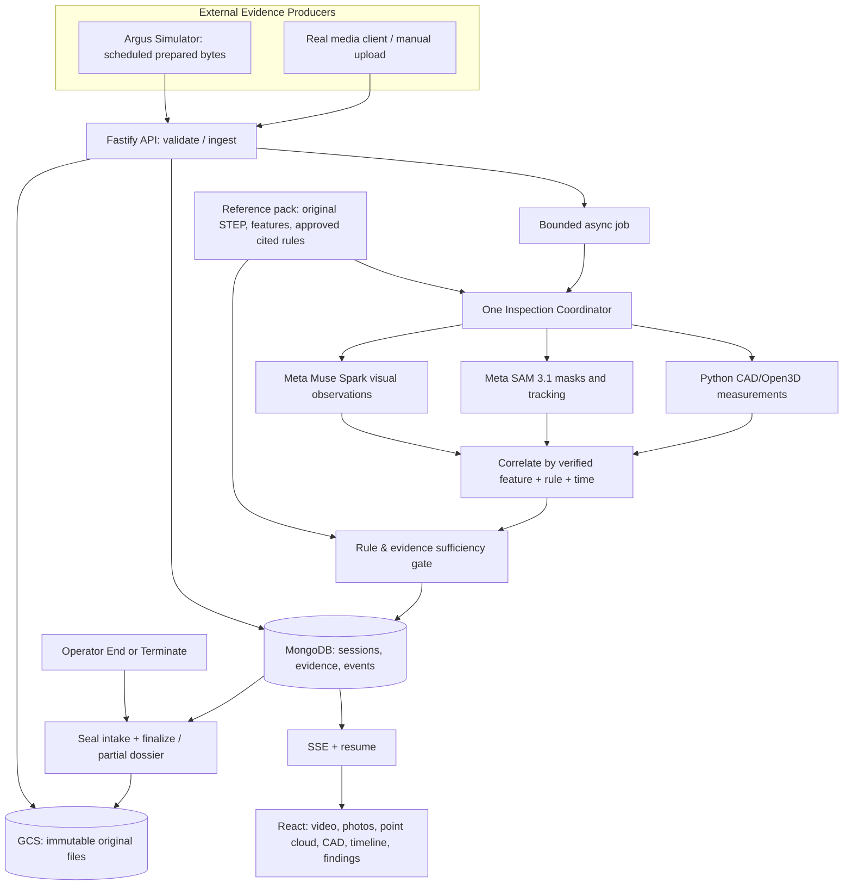

# Argus — Agentic Inspection Architecture

**Document version:** 0.9 · 02 November 2026  
**Repository:** `argus`  
**Functional contract:** `argus/SPEC.md` — Feature Specification v0.9  
**Related:** `argus/TECH_STACK.md` v0.9; `argus-simulator/TECH_STACK.md` v0.9  
**Status:** Architecture for implementation; not a claim that the inspection tooling has been validated on physical equipment.

## 1. The capability being demonstrated

Argus performs **order-specific visual and geometric inspection** of a unique/high-value ETO assembly while evidence arrives. It begins with the actual **48-inch CVS 6000D swing-check-valve STEP assembly** plus numbered approved work-order/inspection instructions, then progressively correlates:

- camera video segments and **actual** frames/capture times;
- close-up photographs and component appearances;
- 3D laser point-cloud geometry, with explicit frames/units/calibration/registration quality;
- the original CAD's verified feature identifiers and applicable work-order rules.

The system's value is avoiding expensive misses and rework while creating a defensible inspection dossier. The MVP does **not** autonomously operate a gantry, inspect X-ray/CT, measure bolt torque, test pressure, infer subsurface crack depth from surface photos or use acoustic analysis.

## 2. Agentic boundary: one coordinator, several tools

**Exactly one bounded Inspection Coordinator** maintains session-specific feature/rule context and selects computational tools on meaningful evidence events. It can: identify candidate feature/rule associations, select visual/geometry processing, request further checks if available, and revise a hypothesis when new evidence arrives.

It **cannot**: change the approved rule snapshot; invent a numerical tolerance, quote, CAD anchor or finding; access Simulator ground truth; rewrite received bytes; close sessions autonomously; assign production release approval.

| Component | Type | Responsibility |
|---|---|---|
| Inspection Coordinator | **One bounded tool-using agent** | Select relevant worklist items/tools and maintain evidence context per feature/rule |
| Reference Pack + Rule Selector | Deterministic/versioned service | Pin original STEP, work order and indexed numbered rules; library → valve type → order applicability; expose selection reasons |
| Video/Photo Analysis Tool | Meta Muse Spark 1.3 adapter | Visual observations grounded in an actual segment/image and quoted rule; can return unknown/occluded |
| Component Segmentation Tool | Meta SAM 3.1 adapter | Object boxes/masks/tracks; separate from defect verdict; optional when useful |
| CAD/Point-Cloud Tool | Python Open Cascade/Open3D | Validate frames/units/pose; register cloud to CAD; quantify feature deviations, residuals, coverage/uncertainty |
| Evidence Correlator | Deterministic typed service | Merge source-specific observations by feature, rule, region, timestamp and verified transform; preserve disagreements |
| Rule & Quality Gate | Deterministic rules engine | Assess modality adequacy, approved thresholds, precision, evidence coverage and rule status |
| Dossier Renderer | Template service | Frozen HTML dossier on operator closure; exact rule citations/evidence IDs, complete or partial |

No separate Planner Agent / Fusion Agent / Reporting Agent persona is required. **Calling tools based on emerging evidence** is the only agentic dimension being claimed; the rest is explicit engineering.

## 3. Architecture and bounded data flows



**Fast ingestion path:** accepted file bytes are stored and the video/photo/point-cloud panel updates **before** inference finishes. A scan chunk is shown incrementally, but count of chunks received is not physical surface coverage.

**Slower analysis path:** an asynchronous job asks coordinator to inspect evidence against applicable criteria; all outputs are persisted with source IDs and limitations before any finding is emitted. `202 Accepted` means **queued, not analyzed**.

**UI stages:** Waiting, Receiving, Analyzing, Ready to Close, Finalizing. Receiving and analyzing may overlap; on a closed session the same evidence and timeline are read-only. The simulator has **no authority** to close the inspection.

## 4. Rule selection and evidence worklist

**At session creation:**

1. Validate required name; select the prepared demo asset reference (single reference pack for MVP) and optional customer/work-order document.
2. Pin original STEP hash, GLB, verified CAD feature map, rule index revision and source document hashes. Preserve a version-pinned quote/page/section for every rule.
3. Select rules by (a) actual rule-library entries, (b) valve type/connection/verified configuration, (c) effective customer or demo work order. Publish dynamic counts and per-rule **Why these rules** rationales.
4. Make a worklist of applicable `ruleId ↔ featureId ↔ expected evidence modalities` and initial `NOT_INSPECTED` states. Keep `REFERENCE_ONLY`, inappropriate or physically unobservable rules separately; don't imply they passed.
5. Display CAD and `WAITING` while awaiting evidence; no fake observation or fabricated progress.

A model may **propose** candidate applicability, but only approved/curated or deterministically mapped criteria can become binding. Bare CAD dimensions do **not** establish an acceptable manufacturing tolerance.

## 5. Inspection decision loop

```text
On accepted evidence event E:
  1. Confirm immutable evidence ID, event ID, source sequence, file hash,
     capture/arrival time, modality and synthetic/real provenance.
  2. Identify candidate CAD feature(s) using genuine visual recognition,
     known media metadata or verified scan pose; record uncertainty.
  3. Find active approved rule(s) whose feature/evidence requirements match.
  4. Select necessary tool(s), not every model for every media chunk:
        photo/video: Muse Spark observation on actual bytes/crops;
                     SAM when box/mask/track improves localization;
        pointcloud:  Open3D geometry registration + bounded measurements.
  5. Normalize results to typed observations with model/tool version,
     evidence IDs, region/frame reference and available limitations.
  6. Correlate by feature+rule+physical frame+time without conflating
     pixels, millimetres, unknown poses or independent defect types.
  7. Apply deterministic applicability, evidence-sufficiency and
     approved-criterion predicates; choose ruleStatus or leave unknown.
  8. Save immutable observation and versioned finding; emit ordered SSE
     observation/finding/rule/coverage events. Update totals and annotation.
  9. Re-evaluate a related rule when new evidence materially changes it;
     keep prior finding revisions. Remain open until operator closes.
```

**Bounded execution:** worker leases/idempotency stop repeated invocation; use timeout and retry budgets for Meta. If a model fails, mark the observation/job failed and rule `INSUFFICIENT_EVIDENCE` or leave `NOT_INSPECTED` as appropriate. Never translate a model timeout into PASS.

### Specific cross-modal rules

- **Hairline on machined flange in close-up:** plausible visual indication; surface scan may be nominal because it cannot resolve the indication. Record suspected surface anomaly and require review rather than claim verified crack depth or certified FAIL.
- **Flange geometry mismatch in scan:** report deviation in millimetres only with known scan units, a validated CAD registration, resolution/uncertainty and approved threshold. If lacking, preserve the observation with `INSUFFICIENT_EVIDENCE`.
- **Fasteners:** unfilled flange pipe-connection holes are normal when uninstalled; only identify missing bonnet fasteners where the specified bolt assembly and visible coverage support it.
- **No detected crack:** never declare the entire body sound from one clean-looking camera frame; scope status to inspected coverage and documented detection limits.
- **Inconsistent media:** retain contradictory observations and provenance; do not erase a suspicion to make the modalities agree.

## 6. Typed data contracts inside Argus

**Evidence context supplied to coordinator** (example, not real physical measurements):

```json
{
  "sessionId": "insp-125",
  "evidenceId": "ev-photo-001",
  "eventId": "img-0001",
  "sourceId": "camera-photos-01",
  "mediaType": "photo",
  "relativeTimeMs": 4800,
  "synthetic": true,
  "referenceSnapshotId": "ref-001",
  "candidateFeatureIds": ["inlet_flange_face"],
  "candidateRuleIds": ["WO-R03"]
}
```

**Visual observation** (model output is provisional, does not carry PASS/FAIL):

```json
{
  "observationId": "obs-001",
  "evidenceIds": ["ev-photo-001"],
  "featureId": "inlet_flange_face",
  "kind": "possible_surface_line",
  "regionPx": { "x": 300, "y": 180, "width": 65, "height": 18 },
  "certainty": "suspected",
  "measurementMm": null,
  "model": "muse-spark-1.3",
  "ruleId": "WO-R03"
}
```

**Geometry observation** (all numeric values below are **illustrative schema examples**, not values measured from this valve):

```json
{
  "observationId": "obs-geom-001",
  "evidenceIds": ["ev-scan-001"],
  "featureId": "inlet_flange_face",
  "registration": {
    "status": "valid",
    "rmseMm": 1.2,
    "surfaceCoverageFraction": 0.65,
    "frameSource": "verified_pose"
  },
  "measurement": { "metric": "local_surface_offset", "valueMm": 0.8, "uncertaintyMm": 0.4 },
  "approvedToleranceMm": null,
  "tool": "open3d"
}
```

**Rule-bound finding** (all quoted text must come from pinned source; this example intentionally contains no invented quote):

```json
{
  "findingId": "f-001",
  "revision": 1,
  "sessionId": "insp-125",
  "ruleId": "WO-R03",
  "ruleStatus": "WARNING",
  "featureId": "inlet_flange_face",
  "sourceSnapshotId": "ref-001",
  "sourceCitationRef": "pinned-work-order:WO-R03",
  "evidenceIds": ["ev-photo-001"],
  "observationIds": ["obs-001"],
  "reason": "Possible narrow surface indication visible in a limited close-up; qualified verification required",
  "cadAnchor": null
}
```

If feature coordinate is not geometrically verified, `cadAnchor=null`; use image-region highlights only. Model text does **not** create its own source quotation or approved numerical acceptance criterion.

## 7. Status and event contract (must match SPEC.md)

| Field | Allowed values | Interpretation |
|---|---|---|
| `lifecycleStatus` | `WAITING`, `RECEIVING`, `ANALYZING`, `READY_TO_CLOSE`, `FINALIZING`, `COMPLETED`, `TERMINATED` | Inspection session progress |
| `outcome` | `PENDING`, `PASS`, `WARNING`, `FAIL`, `INCONCLUSIVE` | Overall conclusion independent of session closure |
| `ruleStatus` | `NOT_INSPECTED`, `ANALYZING`, `PASS`, `WARNING`, `FAIL`, `INSUFFICIENT_EVIDENCE`, `NOT_APPLICABLE` | Per-rule state |
| `deliveryStatus` | `SCHEDULED`, `SENDING`, `ACCEPTED`, `FAILED`, `NOT_SENT` | **Simulator transport only** |

Accepted/processing evidence and findings publish persisted SSE events: `inspection.created`, `evidence.received`, `evidence.processing`, `source.state`, `observation.created`, `finding.created`, `finding.updated`, `rule.progress`, `coverage.updated`, `source.complete`, `inspection.finalizing`, `inspection.closed`, `dossier.ready`, `inspection.error`. UI subscriptions reconnect with `Last-Event-ID` and reload authoritative state as needed.

- **Outcome aggregation:** `FAIL` if verified applicable fail; else `INCONCLUSIVE` if any mandatory applicable rule remains `NOT_INSPECTED`/`INSUFFICIENT_EVIDENCE`; else `WARNING` for verified review/warning; else `PASS` only when all required applicable rules have passed. While session is in progress, `outcome` can stay `PENDING` until sufficiently assessed. On terminate, default `INCONCLUSIVE`, retain verified FAILs prominently.
- **`End Inspection`:** operator seals intake; accepted work drains to deadline; remaining jobs/checks are marked incomplete; freeze records and create **full HTML dossier**, then `COMPLETED` even if overall `INCONCLUSIVE`.
- **`Terminate Now`:** operator seals intake immediately; cancels work promptly; produces **partial HTML dossier**, then `TERMINATED`; subsequent send attempts get `409 SESSION_CLOSED`.
- **`/complete` from Simulator:** sender finished sending; Argus may move to Ready to Close when appropriate, but **never closes automatically**.

## 8. Rule library, documents and dossier boundaries

**Rule library:** indexed, source-numbered records grouped by actual categories; each has document hash, page/section, exact excerpt, applicability marker (`APPROVED / DEMO_ONLY / REFERENCE_ONLY`), modality and optional approved numerical threshold. Library count → valve-type count → work-order selected count derive from real records, not fixed `156 / 114 / 10` values.

**Documents:** session-scoped list reconciles all reference docs/CAD, video/photo/scan files and generated dossier. Show real content length, capture and receipt time, source and download. Generated GLB must not be passed off as canonical STEP.

**Dossier:** frozen HTML report with name/ID, closure mode, lifecycle, final outcome, rule distribution, exact source quotes, observation/evidence/timestamps, validated numeric scan metrics if present, warnings, missing coverage and referenced file hashes; downloadable from the session and Reports. PDF is optional later.

## 9. Agentic non-goals and implementation proof

- No invented acoustic, planning, NDT, robotic or release-approval agents. The coordinator has tools; tools aren't personas.
- No scripted results packaged into simulator requests. The sender sends only real prepared file bytes and minimal transport metadata.
- No pass from a zero-detection photo when the required region was occluded, or when a point cloud lacks valid registration.
- No claim of physical full-surface inspection or calibrated dimensional accuracy without validated sensor setup.
- No assumption every uploaded customer document yields an approved rule or tolerance. If applicability is unverified, expose that limitation.

**End-to-end proof:** new named session; pinned original valve STEP + source rules; simulator sends actual MP4/photo/PLY; UI receives and renders each; Muse Spark produces a source-linked observation from real content; SAM identifies one actual part; Open3D produces a source-linked metric/quality report; a rule gate evaluates or returns inconclusive; operator ends; HTML dossier survives reload. This is sufficient agentic proof for the hackathon.

## 10. Source and change control

- `SPEC.md` v0.9 is the single **authoritative functional source** for screens, routes, API contracts, state codes and close semantics. If this architecture differs, correct this architecture instead of silently changing the feature requirements.
- Meta model integrations follow official documentation: [Muse Spark](https://dev.meta.ai/models/muse-spark), [SAM 3.1](https://dev.meta.ai/docs/sam/overview), [SAM model output parser](https://dev.meta.ai/docs/sam/client-libraries). Model outputs are observations; approved rule text and measured geometry remain separately grounded.
- Broader ETO pitch includes progressive manufacturing-stage inspection and automated sensor/gantry concepts as a long-term vision; the hackathon demonstrates **progressively received** evidence, not physical gantry control.
