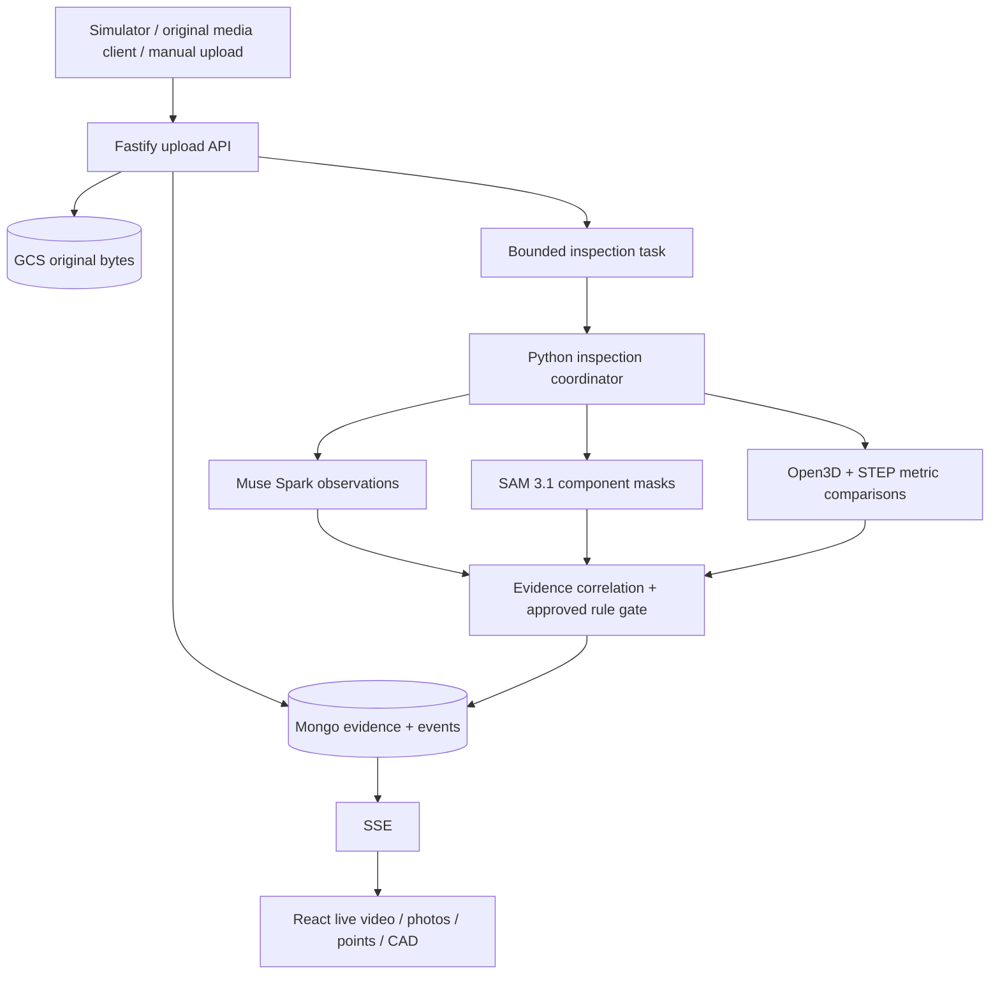

# Argus — Technology Stack & Deployment Design

**Document version:** 1.0 · 03 November 2026 (updated to the implementation)  
**Repository:** `argus`  
**Authoritative functional contract:** `argus/SPEC.md` — Argus Feature Specification v0.9  
**Companion:** `argus/AGENTIC_ARCHITECTURE.md` v0.9; independent `argus-simulator/TECH_STACK.md` v0.9  
**Status:** Proposed implementation stack for the Meta Push the Frontier hackathon; no claim of production-grade inspection certification.

## 1. Design intent

Argus is a **CAD- and order-specific, progressively updating inspection workbench** for one-off/high-value engineer-to-order equipment. It accepts **real video (whole recording or MP4 segments), photographs and 3D laser point-cloud data** from either a simulator or genuine external producers. Each observation is checked against a **pinned original CAD reference and an approved, source-cited rule**. An operator starts, ends or terminates a session; Argus stores the evidence and produces an auditable dossier.

**Value:** detect consequential deviations early and preserve traceability, not simply reduce seconds per inspection. **Scope:** the prepared 48-inch CVS 6000D air-cushioned swing-check-valve reference pack. An original STEP file and its derived display mesh must refer to the same physical assembly as every media asset. Do not substitute a visually convenient but unrelated valve.

## 2. Recommended implementation choices

| Concern | Technology | What it implements |
|---|---|---|
| Web frontend | React + TypeScript + Vite | Home; Inspection Rules; Reports; session tabs, stateful evidence workbench |
| UI styles/controls | Tailwind CSS + accessible lightweight components | Dark, minimal operations UI; working keyboard/empty/error states |
| Client-side 3D | Three.js + React Three Fiber + Drei | Orbitable STEP-derived GLB, true PLY/PCD point display, verified feature highlight |
| Video and photographs | Native `<video>`/images; Canvas overlays | Play received MP4 assets; frame/time selection and image crops; actual, not generated placeholders |
| Main HTTP API | Node.js 22 LTS + TypeScript + Fastify | Session CRUD, ingestion, rule/doc/report API, file persistence, SSE and close controls |
| Request validation | Zod (shared schemas internal to Argus) | Typed multipart metadata, enum and error payload validation; simulator follows published contract but shares no code |
| Analysis worker/API | Python 3.11+ + FastAPI, Pydantic | Bounded inspection coordinator, evidence processing, typed observations, rule predicate execution |
| Imaging/clip preparation | OpenCV + FFmpeg | Validate/prepare frames/crops from actual MP4; preserve source timestamps, avoid redundant inference |
| STEP conversion | Open Cascade via OCP/CadQuery, offline/preload | Canonical STEP, GLB mesh, stable feature IDs, feature-frame mapping; inspect actual reference pack metadata |
| Geometry tools | Open3D + NumPy + SciPy | Load point chunks, coordinate/units checks, registration, per-feature deviations, quality and coverage |
| Multimodal reasoning | Meta Model API `muse-spark-1.3` (Tier 1 screen), `muse-wonder-1.0` (Tier 2 review) | Rule-aware photo/keyframe interpretation; enum-validated observations; never verdicts |
| Component detection + routing | Meta Model API `sam-3.1` + `meta-sam-parser`; `visual-routing.json` | One concept per request, parallel + cached; boxes, one-bit masks (SVG paths), confidence; deterministic table maps visible components to the pinned rules they allow (PRD-10) |
| Order documents | pypdf (layout mode), OOXML (DOCX/XLSX) | Text of the uploaded customer specification; deterministic extraction of rules printed with IDs (WO-R01…) |
| Rule library | Offline indexer `npm run index:rules` (`rules.ts`) | `src/inspection_rules/*.md` + `rule-metadata.json` → content-versioned `rule-library.json`; per-session pinned snapshot |
| Database | MongoDB Atlas | Sessions, references, selected rules, evidence metadata, observations, revisions, event history, dossiers |
| Object storage | Google Cloud Storage | Immutable media bytes, source/reference snapshots, GLB, derived crops/masks, report HTML |
| Browser live updates | Server-Sent Events (SSE), consumed by the web app via `EventSource` | Ordered events with `Last-Event-ID` resume, heartbeat, 15 s reconciliation poll |
| Background work | In-process bounded `AnalysisQueue` in the API (per-kind concurrency, coalescing, drain/cancel); restart recovery from persisted evidence state. Google Cloud Tasks remains the option for a multi-instance deployment | Decouple upload acknowledgment from inference while evidence is still arriving |
| Hosting | React static hosting; Node and Python containers on GCP Cloud Run | Independent services, no Kubernetes requirement; private worker invocation |
| Secrets | GCP Secret Manager / local `.env` (uncommitted) | Meta, MongoDB, GCS credentials server-side only |
| Testing | Vitest + React Testing Library + Playwright, Node integration tests, pytest | API and SSE contracts, source provenance, geometry validation, closure/dossier correctness |

**Not in the MVP:** audio/hiss/acoustic processing; NDT/CT/X-ray; robot/gantry or PLC control; pressure-test automation; a separate vector database; custom model training; autonomous AI-based manufacturing release; login/multi-tenancy. Meta Muse Image, Muse Voice Transcribe and Muse Wonder are not required runtime dependencies. Muse Code can help write code, but is not part of the runtime.

### Model integration notes

- **Tiered, agent-specific routing (updated 2026-11-03, user-approved):** Tier 1 screens *all* video segments and photographs with the fast multimodal model (`META_SCREEN_MODEL`, default `muse-spark-1.3`); VideoAgent never escalates per segment. Tier 2 reviews *only* flagged/high-stakes photographs with the flagship reasoning model (`META_REVIEW_MODEL`, default `muse-wonder` — confirm the exact id and its multimodal/structured-output support on the account at smoke-test time; do not assume a version string). Escalation is deterministic (`meta_adapter.needs_review`: suspected indication, low/unknown certainty, or critical feature — flange faces, nameplate, bonnet, body), never model self-selection. The review is an additional observation; verdicts remain the deterministic rule gate. Point-cloud geometry, rule evaluation, and dossier numbers are never routed to any model.
- For new runtime development target Meta's documented **`muse-spark-1.3`** for the screening tier, not a model-generated measurement engine. Supply only relevant approved rule text, actual images/selected clips and existing candidate feature IDs. Parse to a restricted observation schema and validate it in Python.
- Use **`sam-3.1`** (verified id) via the Responses API, streaming, `metadata: {include_confidence: "true", mask_encoding: "one_bit"}`, one concept per request; parse with Meta's `meta-sam-parser` (`parse_responses_stream`, `decode_mask_to_svg_path`). SAM decides which components are visible and therefore which pinned rules are routed to an image; it never detects a defect or measures a tolerance. A live concept request took ~80 s (03 Nov 2026), so concepts run in parallel (`SAM_CONCURRENCY`), results are cached by image hash + concept, and only components that can route a session rule are prompted.
- **Cost controls:** photos are downscaled to JPEG (`MODEL_IMAGE_MAX_EDGE`), a video segment contributes one keyframe (the clip only for motion rules 8.2–8.4), one segment in `VIDEO_ANALYSIS_EVERY` is analysed (plus the last), and rules already decided are not re-screened from video.
- Deploy **non-contributor/private inference configuration** where applicable for sensitive engineering evidence and confirm account data-handling terms. Store API-call identifiers, model versions and errors for audit.
- Validate file limits, supported clip duration and structured outputs in a real API smoke test. On failures, leave the affected rule incomplete rather than showing a fabricated pass.

Sources for implementation verification: [Meta models](https://dev.meta.ai/docs/models), [Muse Spark](https://dev.meta.ai/models/muse-spark), [SAM 3.1](https://dev.meta.ai/docs/sam/overview), [SAM parsing libraries](https://dev.meta.ai/docs/sam/client-libraries). These are technical integrations, not citations for engineering acceptance criteria.

## 3. Deployable services and ownership

```text
argus/ (one Git repository)
  src/apps/web/                  React frontend (SSE, viewers, SAM mask overlay)
  src/apps/api/                  Fastify REST API, SSE, sessions, uploads, documents,
                                 rules.ts (indexer/selector), analysis.ts (queue)
  src/services/inspection/       Python FastAPI orchestrator (:8100) + agent_service.py
                                 (video :8101, image :8102, pointcloud :8103)
  src/cad_models.json            CAD registry: model_id, family, type, end_connection, hash
  src/data/CAD_files/            registered CAD (STL)
  src/inspection_rules/*.md      rule source documents
  src/reference-data/
    rule-library.json            generated rule index (npm run index:rules)
    rule-metadata.json           stage / evidence / equipment / approved thresholds
    visual-routing.json          SAM component -> rule routing per equipment family
    cvs6000d-48-demo/
      cad/cad_reference.ply      CAD-derived reference cloud (+ .json hash metadata)
      customer-documents/        demo work order, uploaded through the UI
  docs/ (spec, architecture, PRDs, UX)
```

**Separate repository:** `argus-simulator/` has its own React+Node app and scenario folder and calls Argus's public v1 HTTP API. No shared database, runtime or code package is required. Its tech stack lives in the separate repo.

**Node owns:** upload acceptance, GCS objects, MongoDB event sequencing, session lifecycle, source/doc/rule/report queries and SSE. **Python owns:** computational inspection and model calls; it returns structured observations/measurements, never edits source documents. **Browser owns:** playback/visualization from real stored assets and live update rendering. **Simulator owns only:** scheduled transfer of pre-prepared file bytes.

## 4. Functional areas — routes and backing services

| Page / route | Data source | Required behavior |
|---|---|---|
| Home `/` | `GET /api/v1/inspections` | Saved sessions, search, status filters/counts, independent lifecycle and outcome; create named session |
| Global Inspection Rules `/inspection-rules` | `GET /api/v1/instruction-sets` | Indexed library, source and category, computed rule counts, source quotes, search/valve/evidence filters |
| Reports `/reports` | `GET /api/v1/reports` | Persisted completed/terminated dossiers, filters, View/Download |
| Session `/inspections/:id` | session GET + SSE + evidence GET | Waiting → receiving/analyzing; video, photos, incremental points, CAD, timeline, findings |
| Session Applicable Rules | `GET /api/v1/inspections/:id/rules` | Library → type → order applicability, reasons and rule statuses, exact pinned citations |
| Session Documents | `GET /api/v1/inspections/:id/documents` | Actual source/reference/evidence/report bytes, metadata, preview/download |
| Session Dossier | `GET /api/v1/inspections/:id/dossier` | Read-only HTML report after closure; PDF optional, not required |

Start inspection accepts a **required name** and **optional PDF/DOCX/XLSX specification or work order**; absence of upload uses a disclosed pre-pinned demo work order. The reference pack and effective source hashes are fixed at session creation. No global source upload UI is required.

**Session tabs:** active `Live / Applicable Rules N / Documents N`; closed `Inspection / Applicable Rules N / Documents N / Dossier`. Counts are queried, not fabricated. The producer's completion message **does not** close the session.

## 5. Public HTTP v1 contract (normative: `SPEC.md` §10.3)

```text
POST /api/v1/inspections
GET  /api/v1/inspections
GET  /api/v1/inspections/:id
GET  /api/v1/inspections/:id/events            # SSE, Last-Event-ID
POST /api/v1/inspections/:id/video             # MP4
POST /api/v1/inspections/:id/photos            # JPG/PNG
POST /api/v1/inspections/:id/pointcloud        # PLY/PCD
POST /api/v1/inspections/:id/complete          # sender schedule complete, not session closure
POST /api/v1/inspections/:id/close             # operator normal close
POST /api/v1/inspections/:id/terminate         # operator immediate termination
GET  /api/v1/inspections/:id/evidence
GET  /api/v1/inspections/:id/findings
GET  /api/v1/inspections/:id/rules
GET  /api/v1/inspections/:id/documents
GET  /api/v1/inspections/:id/dossier
GET  /api/v1/instruction-sets
GET  /api/v1/reports
```

Optional convenience endpoint: `GET /api/v1/health`; Simulator must not require it if it is not implemented.

### Evidence upload request and acknowledgment

All three media endpoints accept `multipart/form-data`: `file` is the original bytes; `metadata` is a JSON string. **Required metadata**: `schemaVersion:"1.0"`, `eventId`, `sourceId`, `sequence`, `relativeTimeMs` *or* `capturedAt`, `mediaType`, `synthetic` provenance. Point clouds additionally require `units` and `coordinateFrame`; optional verified camera/scan pose must have explicit source/calibration provenance. `synthetic:true` on Simulator files; manual uploads retain their true provenance.

**Acknowledge only after** validating an open session, storing bytes, hashing and committing an evidence record/event. Return `202 {"evidenceId":"...","accepted":true,"processingStatus":"queued"}`; this is **not** an inspected/result status. Idempotency is `(sessionId, eventId)`. Repeated identical requests return their original acceptance; conflicting payload under same ID is a conflict. Treat `400/404/409/413/415` as terminal; `429/5xx`/timeouts may be retried with same event ID.

Close and terminate reject uploads with `409 SESSION_CLOSED` once intake is sealed; do not give a 202 for an upload that cannot be processed or safely stored. Apply bounded payload sizes, secure signed asset URLs and token/network restrictions without creating a login UI.

### Server-Sent Events

Persist and stream ordered events: `inspection.created`, `evidence.received`, `evidence.processing`, `source.state`, `observation.created`, `finding.created`, `finding.updated`, `rule.progress`, `coverage.updated`, `source.complete`, `inspection.finalizing`, `inspection.closed`, `dossier.ready`, `inspection.error`. Payloads include `sessionId`, monotonic `eventSeq`, timestamp and relevant evidence/feature/rule IDs. On reconnect, `Last-Event-ID` resumes where possible; client refetches snapshot to reconcile missed events.

SSE is a **server-to-browser** transport; incoming media is sent over authenticated/restricted HTTP, not SSE. Playback/point visualization must not wait on Meta inference.

## 6. Storage model and provenance

**MongoDB** stores metadata and state; **GCS** stores original and derived bytes. Essential collections:

- `inspections`: name, type, source pack, start/end, `lifecycleStatus`, independent `outcome`, counts, closure mode.
- `ruleLibrary` (or versioned offline index): rule ID/category, source page/section, quote, applicability, evidence requirements, approval marker.
- `referenceSnapshots`: immutable per-session hash/manifest of CAD, rules, documents, optional customer specification.
- `evidence`: `evidenceId`, `sessionId`, `(sourceId, sequence, eventId)`, content hash and GCS key, upload/capture time, type, provenance, unit/frame/pose metadata, processing state.
- `observations`: raw model/tool result with evidence IDs, bounded ROI/mask/feature candidates, confidence/limitations, model/tool/version.
- `findings`: stable `findingId` + revisions, pinned rule ID, status, evidence links, CAD feature anchor only when validated.
- `events`: increasing per-session `eventSeq`, persisted before SSE publish.
- `dossiers`: HTML GCS key, manifest, counts, closure classification, immutable source-linked summary.
- `referenceSnapshots`: per-session pinned rules (`ref-<id>-r<n>`), equipment, library revision, order document hash, cascade counts, sha256.
- `documents`: uploaded customer specification / work order bytes reference, hash and extraction result (order number, rules read, text context).
- `observations`: tool/model output linked to evidence, e.g. SAM segmentation (components, boxes, masks).

**Reference rule hierarchy:** full indexed library → type/feature applicability → selected customer/work-order requirements; actual counts must be computed. Approval `APPROVED / DEMO_ONLY / REFERENCE_ONLY` distinguishes which rules can be asserted. Numeric tolerances **must** come from approved source criteria, never from a bare STEP shape or VLM guess.

**Object immutability:** original uploads are content-hashed; new processing derives new files/observations rather than overwriting original evidence. Completed/terminated session snapshots and dossier records remain read-only. Show a separate generation-error/retry state if an HTML dossier write fails.

## 7. Two data paths: fast evidence and slower inspection



- **On receipt:** show original received MP4/JPG/PLY; point-cloud **chunk receipt** is not surface **coverage**. The CAD viewer uses derived GLB with an immutable link to original STEP.
- **On analysis:** correlate by source event/time, verified 3D feature and applicable rule; produce typed observations, numerical results and rule status with captured limitations.
- **On finding change:** persist immutable finding revision/event, update counts and highlight only a geometrically mapped CAD feature. If no valid map, omit the marker.
- **On close:** stop intake, drain accepted work under a bounded timeout, mark remainder incomplete, render source-cited **HTML dossier**; on terminate, stop intake/cancel work promptly and create partial dossier.

## 8. Lifecycle, inspection result and sender status — never conflate

| Field | Allowed values | Meaning |
|---|---|---|
| `lifecycleStatus` | `WAITING, RECEIVING, ANALYZING, READY_TO_CLOSE, FINALIZING, COMPLETED, TERMINATED` | Session processing progress and closure |
| `outcome` | `PENDING, PASS, WARNING, FAIL, INCONCLUSIVE` | Aggregated inspection conclusion |
| `ruleStatus` | `NOT_INSPECTED, ANALYZING, PASS, WARNING, FAIL, INSUFFICIENT_EVIDENCE, NOT_APPLICABLE` | Evidence sufficiency and decision for a single criterion |
| `deliveryStatus` | `SCHEDULED, SENDING, ACCEPTED, FAILED, NOT_SENT` | Simulator transfer state only |

`PASS` only if all required applicable criteria have adequate evidence and pass; verified `FAIL` dominates; a warning/review indication survives as `WARNING` when no mandatory checks are unresolved; remaining mandatory not inspected or insufficient checks produce `INCONCLUSIVE` (unless a verified fail is present). Terminated sessions default `INCONCLUSIVE`, preserving any verified failed criterion for review. `COMPLETED` means an operator closed the session, **not** that the equipment passed.

Five-stage display: Waiting, Receiving, Analyzing, Ready to Close, Finalizing. Receiving and analyzing can overlap; don't fake an exclusive linear pipeline. Show `N of M` evaluated only for actual applicable, supported checks; progress `analysis` timing is separate from media capture timing.

## 9. Inspection safeguards and operational limits

1. **No crack-depth or sub-millimetre claims from ordinary photos**. A suspected thin line on a flange is a `WARNING`/review indication if relevant, not certified failure proof.
2. **No missing-bolt claim from unused pipe-connection bolt holes.** Bolted bonnet patterns and flange mating holes are different features.
3. **Scan-quality gating:** verified units, coordinate frame, transform, registration error and region coverage before stating a metric; absent/poor data ⇒ `INSUFFICIENT_EVIDENCE`.
4. **Complementary modalities:** normal-looking geometry does not invalidate a visible hairline indication; normal-looking image does not invalidate a qualified 3D deviation.
5. **Accurate traceability:** each finding holds an actual pinned rule quote and real evidence IDs; no invented citations, CAD anchors or ground-truth labels from simulator.
6. **Progressive evidence:** same rule may be re-evaluated; retain revisions and timestamped history, never silently overwrite a prior result.
7. **No automatic certification or release:** Argus assists human quality review only.

## 10. Build/deployment sequence and test gates

| Increment | Outcome | Proof |
|---|---|---|
| 1. Reference pack & sessions | Original STEP-derived GLB/features and quoted numbered rules; Mongo sessions | Accurate Waiting screen, session snapshot and dynamic Rules library |
| 2. Ingestion & SSE | All three media POSTs, GCS writes, idempotency, SSE and downloads | Simulator sends actual bytes; right files appear at received times |
| 3. Live viewers | MP4 viewer, photo grid, accumulating PLY/PCD, CAD and timeline | No source-dependent fake data, point-count vs coverage distinguished |
| 4. One inspection vertical slice | Muse visual observation, SAM mask, Open3D metric, approved rule gate | Auditable real finding with source excerpt and evidence; uncertainty shown |
| 5. Remaining screens | Applicable Rules selection/cascade, Documents, Reports | Counts reconcile with Mongo, explanation links work |
| 6. End and terminate | Draining vs immediate cancellation, HTML dossier | Full and partial immutable report; 409 upload rejection and recovery |
| 7. Harden & demo | SSE reconnect, timeouts, bounded jobs, error states | Playwright + end-to-end actual simulator tests |

**End-to-end demo:** Home → create named session → correct CAD/Waiting → Simulator sends scheduled media → real evidence and model/metric findings update → operator End Inspection → HTML dossier → Reports. Optional midstream Terminate → partial inconclusive dossier.

## 11. Traceability/decisions

- Feature Spec v0.9 is the **normative source** for screen/page behavior, API endpoints and lifecycle semantics; if this technical document conflicts, follow SPEC.md and reconcile the design before coding.
- Argus's core runtime dependency on Meta is `muse-spark-1.3` / `muse-wonder-1.0` + `sam-3.1`; the former interpret actual media and the latter detects which components are visible (routing). Neither substitutes for deterministic measurement nor supplies engineering rules.
- No global instruction-source upload feature is needed; session-specific optional work-order upload **is** included. Index source rules before a demo, preserve their original numbering, and distinguish `REFERENCE_ONLY` from testable rules.
- Registration (answered 03 Nov): the prepared chunks carry no external pose; Argus registers the **merged** scan to its CAD reference by ICP and gates every scan rule on ICP fitness and CAD-surface coverage. Millimetre conformance is claimed only against the approved DEMO_ONLY thresholds of GEO-001…003 (RMS ≤ 3.0 mm, p95 ≤ 6.0 mm, coverage ≥ 80%).
